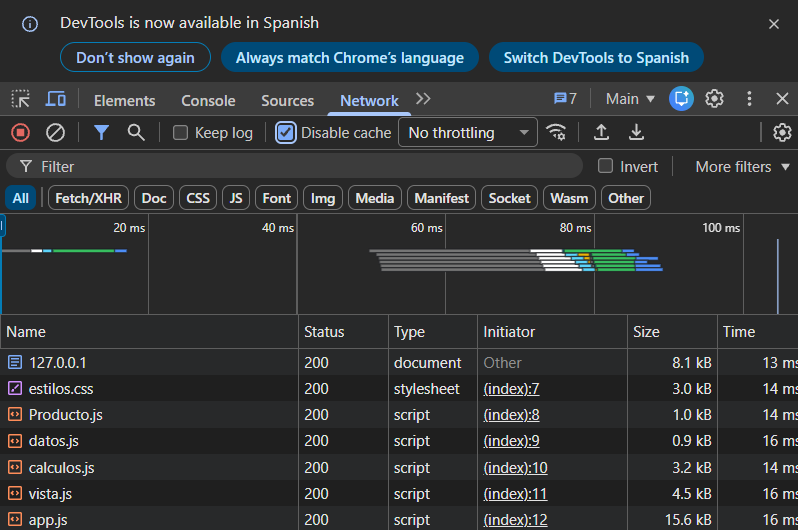
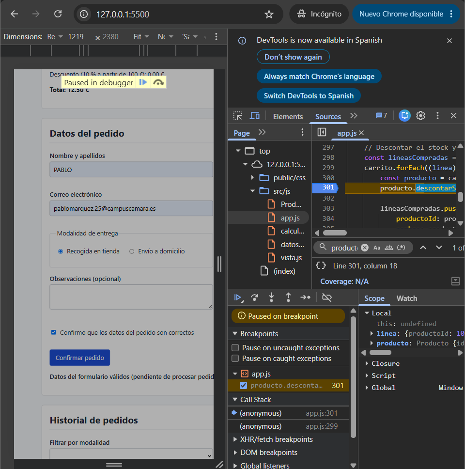

# Practica UD2 - Entorno Cliente
## Tienda Online Modular — Gestión de Catálogo, Carrito y Pedidos
Este trabajo trata de desarrollar una aplicación web para consultar un catálogo de material informático o de oficina, gestionar un carrito y confirmar pedidos. Toda la lógica se ejecutará en el navegador mediante HTML, CSS y JavaScript. Se trabajará con funciones, arrays, objetos, eventos, formularios y validación de datos.

Esta práctica la he realizado junto con el apoyo de la IA, guiándome paso a paso y ayudándome en los errores que he tenido. Dejo por aquí el enlace al chat con Gemini: https://gemini.google.com/share/d/1lYtPoRnDOwnoud5C7kKp9pjVoGLLXdJq?usp=sharing

## 1. Estructura y explicación de los archivos

El proyecto sigue una arquitectura modular que separa el modelo de datos, el estado, la lógica pura de negocio, la construcción del DOM y la gestión de eventos:

* **`index.html`**: Estructura semántica HTML5 dividida en cuatro secciones principales: catálogo con filtros, carrito con etiquetas `<output>` para los totales, formulario de pedido con atributo `novalidate` y elementos `<small>` para errores, e historial de pedidos con exportación JSON[cite: 3, 4].
* **`public/css/estilos.css`**: Hoja de estilos con diseño *responsive*, maquetación en rejilla para las tarjetas y estilos visuales asociados a estados de accesibilidad (`aria-invalid="true"`).
* **`src/js/Producto.js`**: Define la clase de dominio `Producto` con sus propiedades (`id`, `nombre`, `categoria`, `precio`, `stock`) y métodos de instancia (`hayStock(cantidad)` y `descontarStock(cantidad)`) para encapsular la gestión del inventario.
* **`src/js/datos.js`**: Contiene el listado inicial de instancias `Producto` que forman el catálogo y los arrays de estado en memoria (`carrito` y `pedidos`).
* **`src/js/calculos.js`**: Agrupa las funciones puras de lógica de negocio y validación (`calcularSubtotal`, `calcularDescuento`, `validarDatosPedido` y `calcularResumenHistorial`), totalmente desacopladas del DOM para facilitar su prueba y mantenimiento.
* **`src/js/vista.js`**: Encargada de construir de forma segura los elementos visuales del catálogo, las líneas del carrito y las tarjetas desplegables (`
` / `
`) del historial mediante `document.createElement()` y `textContent`, evitando `innerHTML` para prevenir inyección de código (XSS).
* **`src/js/app.js`**: Controlador principal que enlaza el estado con la interfaz. Gestiona el pintado dinámico (`replaceChildren()`), la delegación de eventos en listas, la validación en vivo mediante la *Constraint Validation API* (`setCustomValidity`, `reportValidity`), la transacción de confirmación de pedido y la serialización a JSON (`JSON.stringify`).

## 2. Pruebas realizadas (10 casos funcionales + 2 evidencias DevTools)

| ID | Caso de prueba | Procedimiento / Entrada | Resultado obtenido | Estado |
| :--- | :--- | :--- | :--- | :---: |
| **CP-01** | **Filtrado del catálogo** | Buscar `"rat"` y seleccionar categoría; después buscar `"zzzz"`. | Filtra combinando ambos criterios y muestra aviso cuando no hay coincidencias. | Superado |
| **CP-02** | **Añadir y acumular unidades** | Añadir 2 unidades de un producto y volver a añadir 3 del mismo. | Agrupa ambas acciones en una sola línea con 5 unidades y recalcula importes. | Superado |
| **CP-03** | **Límite de stock al añadir** | Intentar añadir más unidades de las disponibles o valores no enteros (`0`, `-1`, `1.5`). | Bloquea la acción y muestra aviso de error en el carrito sin alterar totales. | Superado |
| **CP-04** | **Descuento por umbral (100 €)** | Añadir artículos por debajo de 100 € y superar después dicho importe. | Aplica `0.00 €` bajo 100 € y calcula automáticamente el 10 % al alcanzar o superar 100 €. | Superado |
| **CP-05** | **Eliminar líneas del carrito** | Pulsar el botón **Eliminar** en cada línea hasta vaciar el carrito. | Elimina cada fila individualmente y reinicia los `<output>` a `0` y `0.00` al quedar vacío. | Superado |
| **CP-06** | **Validación de campos y espacios** | Introducir `"   "` en Nombre, `"correo@mal"` en Email y no marcar condiciones. | Frena el envío, pinta cada error en su `<small>`, marca `aria-invalid` y enfoca el primer fallo. | Superado |
| **CP-07** | **Entrega condicional y CP español** | Seleccionar **Envío a domicilio**, probar CP `53001` y `41001`, y volver a **Recogida**. | Rechaza `53001`, acepta `41001` y al volver a recogida oculta el bloque y limpia errores. | Superado |
| **CP-08** | **Pedido con carrito vacío** | Rellenar el formulario con datos válidos teniendo el carrito a `0` unidades. | Impide registrar el pedido y avisa de que debe añadirse al menos un producto. | Superado |
| **CP-09** | **Confirmación, stock y reinicio** | Confirmar un pedido agotando el stock de un artículo y comprando otro. | Descuenta stock en catálogo (marcando `"Sin existencias"`), vacía carrito y resetea el formulario. | Superado |
| **CP-10** | **Historial, filtro y JSON** | Registrar pedidos de recogida y envío, alternar el filtro y pulsar **Exportar historial**. | Actualiza tarjetas y contadores según filtro, despliega líneas con `
` y genera el JSON. | Superado |
| **CP-11** | **DevTools — Carga en red (`Network`)** | Recarga forzada con caché desactivada (`Disable cache`) en ventana de incógnito. | Todos los recursos (`127.0.0.1`, `estilos.css` y los 5 scripts `.js`) cargan con estado HTTP `200`. | Superado |
| **CP-12** | **DevTools — Depuración (`Sources`)** | Punto de interrupción en `app.js` (línea `301`: `producto.descontarStock(...)`) al confirmar. | Ejecución pausada inspeccionando en `Scope` la instancia `Producto` y la línea del carrito. | Superado |

## 3. Capturas de verificación en Chrome DevTools

### CP-11: Carga correcta de módulos en red (`Network`)

*Verificación con caché desactivada donde se comprueba la carga sin errores (HTTP `200`) del documento principal, `estilos.css` y los módulos `Producto.js`, `datos.js`, `calculos.js`, `vista.js` y `app.js` en orden de dependencia.*

### CP-12: Punto de interrupción en el descuento de stock (`Sources`)

*Ejecución detenida en la línea `301` de `app.js` justo antes de ejecutar `producto.descontarStock(linea.cantidad)`. En el panel lateral `Scope` se verifican en tiempo real los valores de `linea` y la instancia `Producto` antes de actualizar el inventario.*
